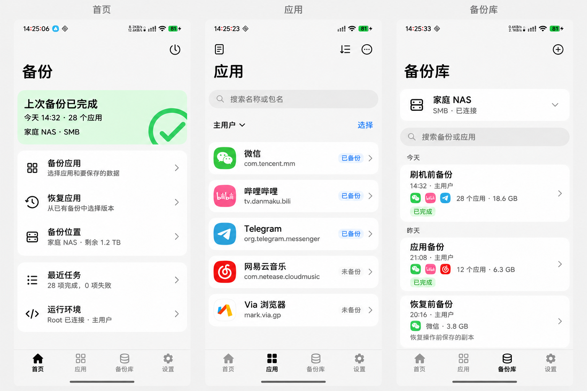
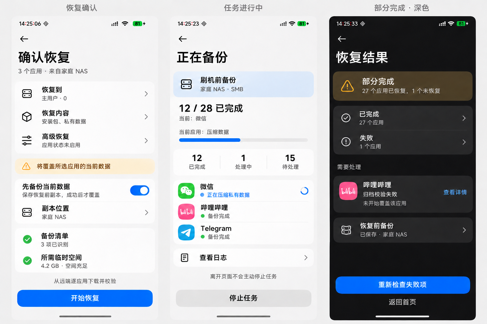

# HyperBackup

基于 [backup_script](https://github.com/YAWAsau/backup_script) 完整业务执行能力的独立 Android 备份恢复 App，采用 Miuix UI，并持续跟进上游新能力。

**当前阶段：开发进行中，正式首版尚未完成。设计基线 r2 已确认。** 2026-11-08，项目目标从精简首版调整为完整覆盖固定版本脚本的业务能力。缺项属于预览版待办，不能继续作为正式首版排除。

## 已确认的产品与架构

- 首个正式可用版本完整覆盖备份、恢复、配置、维护、诊断与执行辅助；范围以源码能力矩阵为准，不只看 README 主功能表。
- 保留完整上游 Shell/Dex/Rust/工具业务主线，维护窄宿主桥接；不平行重写一套备份恢复逻辑。
- 与声明支持的原脚本版本双向兼容，保留原生备份根和 metadata；App 索引、任务及 hash 是附加层。
- 提供“新建备份集”和“更新已有备份集”，默认新建保留历史；更新使用上游 fast-skip，不伪称新增历史快照。
- 支持流式/非流式备份以及下载后/直接串流恢复；默认下载后恢复，应用恢复前副本默认开启并可明确关闭。
- 用户界面沿用 KernelSU Miuix 四入口和蓝紫色数据堆叠图标，不要求照搬上游壁纸/玻璃/背景动画。
- 上游更新先做差异分析、适配和回归，再随 HyperBackup APK 发布。每版锁定源 SHA、配套产物、补丁和协议，运行时不直接执行 latest。

Android 基线沿用上游：Android 9+、arm64、Root；Magisk/KernelSU 与其他环境须分别列出验证结果。平台限制、安装未知结果、局部事务和部分写入均如实报告，不承诺任意应用免登录或整批回滚。

## 文档

| 文档 | 内容 |
| --- | --- |
| [完整能力矩阵](docs/UPSTREAM-PARITY.md) | 38 个业务能力组、固定源码定位、入口与验证状态；是正式发布门槛 |
| [持续跟进上游](docs/UPSTREAM-SYNC.md) | 多来源差异检查、补丁/产物锁定、兼容回归与 APK 更新 |
| [架构](docs/ARCHITECTURE.md) | 5 模块、完整引擎调用、Root/AIDL、配置和生命周期 |
| [功能边界](docs/BOUNDARIES.md) | 正式首版覆盖、模式、源限制与明确差异 |
| [格式与互操作](docs/DATA-FORMAT.md) | 原生备份集、附加索引、新建/更新和双向兼容 |
| [UI](docs/UI-SPEC.md) | 四入口、全能力信息架构、页面状态与 Miuix 组件约束 |
| [验证计划](docs/VALIDATION-PLAN.md) | 开发里程碑、覆盖证据、互操作和故障回归 |
| [图标](docs/BRANDING.md) | 蓝紫色数据堆叠图标与 Android 图标资源边界 |
| [术语](GLOSSARY.md) | 能力基线、备份集/批次、账号/用户映射和双向兼容 |
| [来源](docs/SOURCES.md) | 固定 SHA、官方 API 与实机视觉证据 |

## 视觉基准

一级入口为 **首页 / 应用 / 备份库 / 设置**；任务通过首页时钟、最近任务、运行状态与通知进入。通用流程视觉保持，新增的其他数据、维护和高级配置按 UI 规范扩展。

概念图是视觉参考，不代表覆盖所有功能或已经通过设备验收。内置 imagegen 提示词保留在 ui/；图标依 [BRANDING.md](docs/BRANDING.md) 制作实际 Android 资源。

## 固定技术与能力基线

| 项目 | 版本 | 用途 |
| --- | --- | --- |
| backup_script | [v1117 / 4d85ef6](https://github.com/YAWAsau/backup_script/tree/4d85ef6f974dc8b4a9208dd2aa9578a3d69e1ab5) | 当前完整业务覆盖目标，非已完成声明 |
| Android-DataBackup | [c306d75](https://github.com/XayahSuSuSu/Android-DataBackup/tree/c306d7539a1ceed8ef42b3936dcfa03bb9fdcdac) | 产品流程和进程边界参考 |
| Miuix | [0.9.4 / 39c40f9](https://github.com/compose-miuix-ui/miuix/tree/39c40f99844227b853f0049a0933b1f3ae6c00ba) | UI 组件基线 |
| libsu | [6.0.0 / 8c3e80f](https://github.com/topjohnwu/libsu/tree/8c3e80ffe466b89ff875471e542d77e6a1b480c5) | daemon RootService 与 AIDL |

## 决策沿革

有效：[ADR-0001 独立 APK](docs/adr/0001-independent-app-engine-boundary.md)、[ADR-0004 沿用源应用策略](docs/adr/0004-inherit-engine-app-policies.md)、[ADR-0005 Root daemon](docs/adr/0005-root-daemon-and-reconciliation.md)、[ADR-0006 完整能力与备份集](docs/adr/0006-full-parity-and-backup-sets.md)、[ADR-0007 双向格式与恢复模式](docs/adr/0007-native-format-and-restore-modes.md)、[ADR-0008 持续跟进](docs/adr/0008-track-upstream-through-tested-app-releases.md)。

历史：[ADR-0002](docs/adr/0002-immutable-backup-batches.md) 和 [ADR-0003](docs/adr/0003-staged-restore-and-safety-copy.md) 已被替代，不再据其限制业务范围。r1 专用载荷容器也不再是正式格式。

从 P0 完整引擎/宿主验证起，推进至能力矩阵和双向互操作全部满足。中途可交付预览 APK，只有达到正式门槛才标为首个完整版本。应用命名、构建依赖、包名和签名配置由实施记录，正式包名必须用于宿主保护和身份校验。
