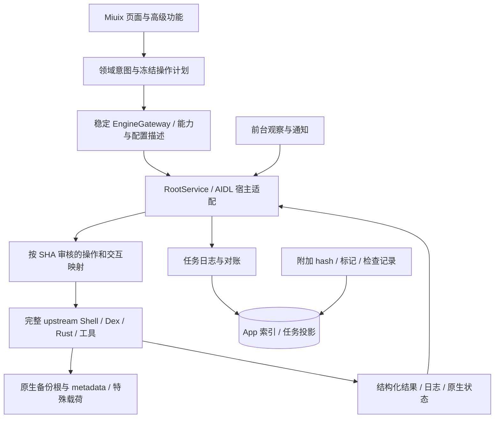

# 架构与完整引擎适配边界

状态：r2，2026-11-08。正式首版完整覆盖上游业务，保留批准的独立 APK、Miuix、Root daemon 与任务对账方向，替代 r1 的精简业务和专用载荷容器。设计不等于已完成验证。

## 核心原则

**保留完整上游执行主线，维护窄的宿主适配层。** tools.sh、Dex、Rust 和配套工具共同构成业务引擎。不能只打包其中四个二进制、在 Kotlin 里重写备份/恢复后声称完整移植；压缩、fast-skip、安装、通信记录、特殊应用、传输/修复逻辑由锁定的上游流程承担。

App 记录用户意图、任务 ID、观察与附加索引；上游执行配置及流程负责业务语义。任务日志与原生状态存在时间差时，标为待核对，不依据最后一条 UI 日志断言未发生覆盖。

## 模块

沿用 5 个 Gradle 模块，先按 feature 包组织页面：

| 模块/目录 | 职责 | 边界 |
| --- | --- | --- |
| :app | 四入口、业务/高级流程、ViewModel、前台服务、通知与依赖组装 | 不拼任意 Shell，不平行写业务规则 |
| :core:domain | 类型化备份对象、计划、映射、结果/限制、接口 | 不依赖 Android UI、数据库实体 |
| :core:data | 设置展示、凭据保护、索引、草稿、任务投影和重建 | 上游配置含义不另设一套默认值 |
| :core:engine | Root 会话、完整工具安装、版本握手、操作映射、交互应答与对账 | 不能以重写业务取代调用上游 |
| :core:ui | Miuix 主题、列表/状态/表单/选择组件 | 不访问 Root、网络、数据库 |
| engine/upstream | 固定原始上游树，来源与许可 | 不随意修改或追踪运行时 latest |
| engine/patches | 最小宿主/控制/输出适配，逐补丁来源、理由、测试 | 不成为第二套上游业务流程 |

技术基线仍为 Android-only Kotlin/Compose、Miuix 0.9.4、libsu 6.0.0 daemon RootService + Binder/AIDL、Coroutines/Flow、Room/DataStore。最低 API 28、arm64。具体编译依赖和平台 target 在实现中锁定并验证。

## 宿主适配

必须覆盖：新包名/签名、Root bootstrap、工具私有版本目录、菜单和表单响应、路径选择、App 返回/前台、通知、日志/任务命名空间、自身保护及更新行为。

原始 AppListReturn/applist_web 校验 SpeedBackup 包名/证书/版本并可能安装原 APK；原始更新器会剪裁和覆盖 tools。因此不能未经适配直接运行完整包的宿主路径，也不能把桥接放在未登记的会被清理位置。

UI 不直接依赖原始 loopback 菜单 ID。桥接可以在固定 SHA 的适配器内部利用已审核的原生会话/业务入口，但必须把它转换为稳定操作、参数和结果契约。数字菜单 ID 随行号变化，严禁跨版本盲用。

优先添加小型宿主入口和结构化控制补丁，继续调用原函数/流程。为测试可替换 transport/clock/system 查询边界，不复制安装、归档、恢复或特殊对象策略。暂时不可组合的上游交互是桥接待适配项，不是删除功能的理由。

## 控制契约

外部 bridgeProtocol=1 可作为起点，协议与上游版本分别标识。Root 服务持有独立执行作用域、单作业控制权和唯一任务日志写者；AIDL 快速受理，大清单/日志使用 PFD。bind/unbind 遵守库主线程要求，受限 Root Context 不当完整 Android Service Context 使用。

| 能力 | 合同要点 |
| --- | --- |
| handshake/capabilities | upstream SHA、组件、补丁/工具 hash、协议、操作/对象/配置能力及限制 |
| inventory/catalog | 多用户应用及各类型备份对象，分页/未知大小、原生格式识别 |
| config inspect/validate/apply | 版本对应的公开键/默认值/枚举、上游 codec 与迁移，不执行任意配置代码 |
| preflight | 生成冻结计划：operation ID、对象、来源/目标、模式、配置摘要、阻断/提醒 |
| submit | taskId/requestId/plan digest 幂等受理，相同 ID 不重复执行 |
| interaction | 绑定 taskId 的类型化用户选择/表单响应；校验允许的选项和阶段 |
| events/status/result | 序号、当前阶段、计数/大小、源结果和限制；自然语言日志不是唯一成功依据 |
| requestStop/reconcile | 区分请求接收、收尾、已停止、强停、失败、未知；查询先于重试 |
| maintenance | 测试连接、扫描、上传、清理、检查、修复、诊断等稳定 operation，复用同一作业框架 |

发现新源菜单或新复杂交互时要更新能力矩阵与版本映射。未知 operation/config 不直接透传任意执行，也不伪装成支持。

## 配置与凭据

以固定上游的配置 codec、模板、默认值、保留/废弃字段规则为执行权威。App 只映射字段展示和安全凭据引用；不要修改现有值来迎合 App 自己的默认表。

保留备份/恢复不同默认值、黑白名单、压缩/小文件、路径/后缀、流式/保留、运行辅助与清理等配置。只在用户选择或已批准的 App 默认（新建集、下载后恢复、应用恢复前副本、AppState 高级恢复默认关闭）上显式覆盖计划，展示与原生默认的区别；选项本身仍完整开放。

凭据由 Keystore 保护的私有存储管理，仅在运行需要时通过受控通道提供给原业务配置/进程；不进入 argv、公开索引或导出诊断。格式和凭据迁移分开，刷机后可重新配置连接。

## 生命周期与结果

- 一次一个 App 修改作业；UI 可浏览/编辑其他草稿，不能重复提交恢复。
- daemon 拥有执行，客户端回调失联不等于失败；显式重连后核对 daemon epoch、boot、任务、引擎身份和事件游标。
- App 更新、Root 撤销、系统 Stop、daemon/native 进程被杀、设备重启各自验证，不宣称永不被杀或自动续传。
- FGS 与 Root 保持有界控制会话；失联时按可验证的上游阶段安全收尾，不用后台 Root 规避系统停止。
- 调用可能覆盖的上游流程前持久化潜在写入状态；失联后保守对账，不能因为未收到数据阶段事件而宣称目标未修改。
- 停止结果忠实暴露 graceful/forced/failed 和实际已写入范围，不把取消等同回滚。App 的保守停止/未知结果保护是明确的控制差异，需与源行为一起回归；不能直接以 RootService.stop 代替安全取消。
- 单项已知失败可继续；存储/Root 故障、安装未知等停止并对账。可选 AppState 未支持与实际执行失败分别报告。
- 状态包括进行中、成功、警告、部分完成、失败、跳过、取消和未知；全部必选目标成功才是完整成功。每个原生特殊流程都要映射结果，而非统一 exit 0。

源通信记录合并、Timeline 事务、下载发布交易等局部能力按真实范围呈现，不扩写为整批原子恢复。宿主保护不能用禁用所有系统应用替代。

## 存储与更新边界

原生备份根/payload/metadata 是格式权威。App 附加索引/hash 可缺失、可重建；不要求原脚本理解 App schema。原脚本外部写入不遵守 App 私有锁，任何并发和身份未知须被检测并解释。新建/更新的关系见 DATA-FORMAT.md。

上游新能力只经测试后随 APK 发布。发布锁包含源 SHA、配套工具、宿主补丁、能力/配置快照与协议。禁止原始 updater 覆盖 App 工具；更新不能在任务中替换执行版本。完整机制见 UPSTREAM-SYNC.md。

## 当前实现的迁移要求

已可复用的 Miuix 页面、Root/AIDL 生命周期、持久任务、凭据和 CI 可保留。只包装 tar/zstd/Dex 而自行实现 Capture/Restore 的流程，应逐步替换为完整上游调用；硬编码压缩参数和 App 专用载荷布局不可成为正式版基础。

先证明完整工具/宿主路径可用与原生格式互读，再扩展全能力入口。P0 成功不等于正式首版完成；最终按 UPSTREAM-PARITY.md 全部业务项和平台限制验收。
