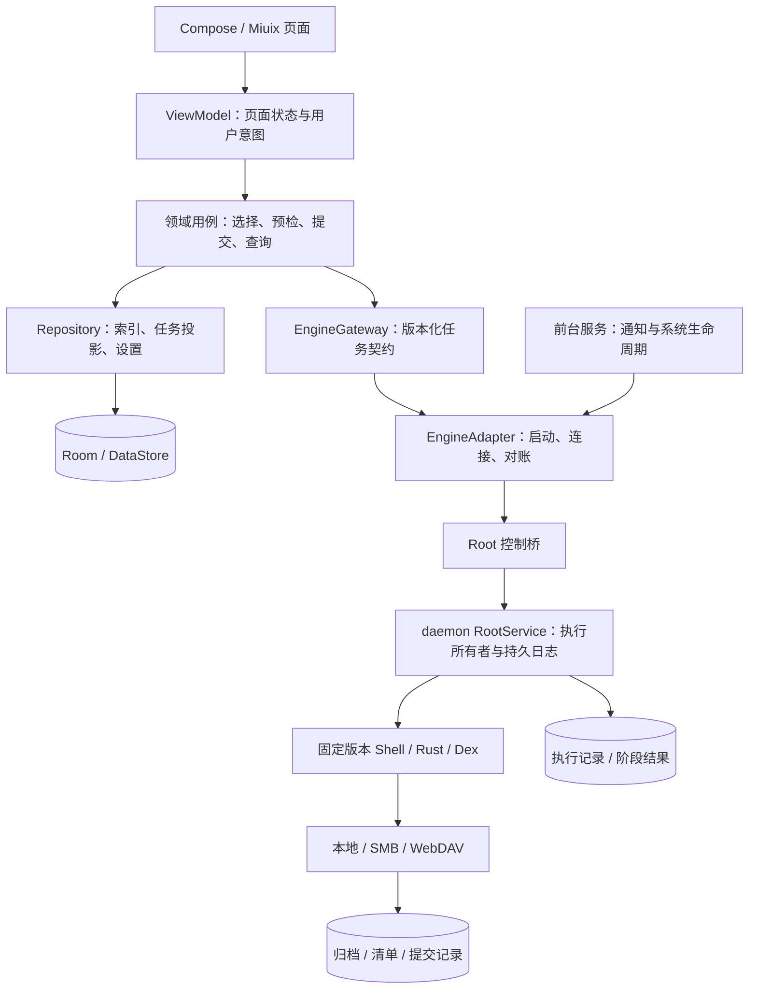
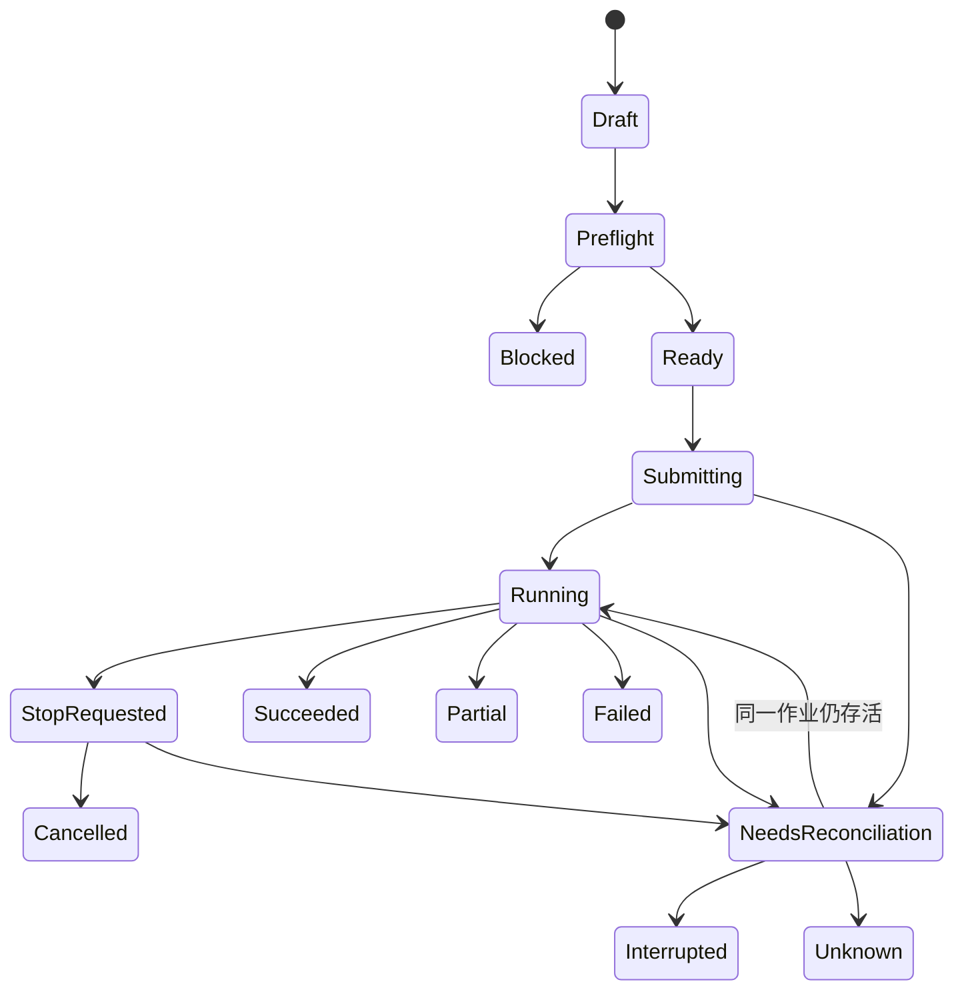

# 架构与执行边界

状态：2026-11-08 随整体 v1 设计确认并冻结；不存在已实现或已通过实机验证的暗示。

## 总体方案

采用 Android 原生 Kotlin + Compose + Miuix，封装固定版本的 backup_script 执行能力。UI、应用数据层与 Root 执行层分开；应用自己的备份格式及任务协议不依赖脚本菜单编号。首版不开发跨平台客户端，不 fork DataBackup 的完整业务代码。

图中的 Root 控制桥、类型化作业接口、持久化对账与新备份容器是新增设计，不是 upstream 已提供的完整 SDK。

## 工程结构

首版采用 5 个 Gradle 模块，按职责组织；页面先按 feature 包隔离，达到独立构建需求时再拆模块。

| 模块 / 目录 | 职责 | 禁止承担 |
| --- | --- | --- |
| `:app` | 启动、依赖组装、FGS、路由、feature/home/apps/library/task/settings 的页面与 ViewModel | 拼 Shell、直接操作备份归档 |
| `:core:domain` | 领域模型、用例、预检策略、Gateway / Repository 接口 | Android Context、数据库实体、UI 组件 |
| `:core:data` | Room 索引与任务投影、DataStore 偏好、目的地配置、凭据库、导入重建 | 发起不受任务协议约束的 Root 写操作 |
| `:core:engine` | Root 会话、资源安装、版本握手、协议编解码、事件对账、上游适配 | 页面状态、UI 文案、第二套备份决策 |
| `:core:ui` | Miuix 主题、公共应用行/状态卡/选择条/结果项 | 直接访问 Root、数据库或网络 |
| `engine/upstream` | 锁定的上游代码及来源、许可证、构建脚本 | 直接追踪 latest 自动运行 |
| `engine/patches` | App 专用非交互入口、结构化事件、取消与格式适配 | 与 UI 布局耦合 |

依赖方向：app 组装全部模块；data / engine 依赖 domain；ui 不依赖 data / engine。用例只依赖接口，避免在 ViewModel 内协调网络、Root 与数据库事务。上游约 4 万行的 tools.sh 是遗留边界，不再向该文件堆入 App 页面逻辑；新增桥接职责按启动、计划、执行、取消、结果拆分。

技术选型：Miuix 固定 v0.9.4；Android-only Compose、Kotlin Coroutines / Flow、Room、DataStore；libsu 6.0.0 daemon RootService + Binder/AIDL。Kotlin / Compose / AGP 的确切组合在编译验证阶段锁定，不因 Miuix 自身仓库使用某版本就直接照搬。最低 SDK 28，ABI arm64-v8a；compile / target SDK 在实现前按当时 SDK 与分发要求核定，不降低 target 来规避任务约束。

## 三种权威数据

1. **备份是否存在和可读：目的地清单与提交记录。** Room 是可重建索引；刷机后添加原目的地即可扫描本应用格式，不依赖旧手机数据库。
2. **Root 步骤是否执行：Root 执行记录及系统实际状态。** UI 显示超时不是执行失败证据；Binder/网络断开也不是任务完成证据。
3. **用户尚未提交的选择：应用草稿。** 提交时生成不可变计划，运行过程中不修改其应用集合、用户映射、目的地或覆盖策略。

不尝试跨 Room、Root 日志和 NAS 做一个分布式事务。通过不可变身份、提交记录和可重复查询进行对账；发生冲突时进入待确认状态。

## 引擎适配契约

协议 `bridgeProtocol=1`，使用封闭命令集合。客户端通过 libsu 6.0.0 的 daemon RootService、Binder/AIDL 与执行层通信；Intent 使用 `RootService.CATEGORY_DAEMON_MODE`。普通默认模式会因最后一个客户端解绑而销毁服务，不满足本设计的执行所有权。UI 不接入上游 loopback 菜单协议；上游业务入口需适配为非交互作业调用。

RootService 是任务的唯一执行所有者，持有独立执行作用域、单作业锁与唯一 journal 写者；ViewModel/客户端协程不拥有实际任务。AIDL 请求快速受理，实际文件工作不在 Binder 线程上阻塞。大量清单/日志使用 ParcelFileDescriptor，避免 Binder 大事务；bind/unbind 按库契约在主线程发起。RootService 的受限 Context 不当普通 Android Service Context 使用。

| 命令 | 关键输入 / 输出 |
| --- | --- |
| `capabilities` | 引擎版本、协议、ABI、用户、数据类型、存储与校验能力、限制 |
| `inventory` | 指定用户与游标 → 应用列表、安装身份、可访问状态；大小允许未知 |
| `inspectRepository` | 目的地引用 → repoId、格式版本、清单、可读写能力、容量（可未知） |
| `preflight` | 操作草稿 → 不可变 planId / digest、估算、阻断项、提醒及检查时刻 |
| `submit` | taskId、planId、digest、requestId → 新建或返回同一作业 |
| `status` / `events` | taskId、afterSequence → 当前快照与严格递增事件 |
| `requestStop` | taskId、requestId → 已接收 / 已停止 / 不支持当前阶段立即停止 |
| `result` / `reconcile` | taskId → 分项结果、写入阶段、核验范围、是否允许重新规划 |
| `deleteBackup` | repoId、明确的备份 ID、预计清单摘要 → 删除作业及逐项结果 |

每个回应包含协议版本、taskId/requestId、结果码、可读错误参数；错误码与 UI 文案分离。日志只用于诊断，不解析自然语言日志来推断成功。提交与停止请求必须幂等：同 ID 同载荷返回原记录，同 ID 不同载荷拒绝。提交响应丢失后先查询该 ID，禁止重新生成 ID 重发恢复。

事件最少包含 `sequence / taskId / itemId / phase / outcome / bytesDone? / bytesTotal? / reasonCode / timestamp`。未知总量用不确定进度；按项目数计算的比例必须明确写“项目进度”，不能冒充字节进度或剩余时间。

## 生命周期与并发

- 全局仅一个修改型作业，包括备份、恢复、删除、修复。用户可继续浏览或编辑未提交草稿；首版不排队自动执行第二个作业。
- 提交按钮立即防重，持久化 taskId 后才发送请求；Root 端记录接收后才确认。数据库唯一键与 Root 锁共同防双执行。
- FGS 承担通知和 Android 生命周期，不能承担唯一任务状态。后台限制、用户停止、进程回收都必须进入验收。
- daemon 在最后一个客户端解绑后可存活，重连由 App 显式发起；回调死亡只移除观察者。其跨 Android 用户复用特性不代表授权或用户自动继承，每次请求明确客户端身份、来源用户和目标用户。
- App 更新/卸载可能直接终止 daemon，不能依赖 onDestroy 清理。运行中禁止应用内升级动作；外部安装更新属于异常中断路径。绝不以 `RootService.stop()` 代替任务的安全停止。
- FGS 与 Root 服务保持有界运行会话租约：UI 离开不撤销租约，通知/控制进程失联后不无限无人观察地开始新项目；在安全点停止并保留可对账结果。租约时限通过 P0 设备测试确定，不把 daemon 当作规避系统 Stop/超时的机制。
- 关闭页面只退出观察；返回可重新接入仍活着且身份匹配的会话。匹配条件至少包含 taskId、bootId、进程启动身份、协议和引擎版本，不能只看 PID。
- Root 执行器记录每个不可逆步骤的开始与结果。父进程/观察者失联按已验证的会话策略处理，不能据“以 root 运行”就承诺永不被杀。
- 调用可能写入的上游流程前，先持久化该条目已进入潜在写入阶段。细粒度事件丢失时保守标为待核对，不能因为最后一条可见日志仍为下载阶段就断言未发生覆盖。
- `requestStop` 表示请求停止；进入 STOP_REQUESTED 后停止新应用，并等待当前步骤到安全点，完成清理后才报告 CANCELLED。无普通“暂停/继续”按钮。
- 不照搬上游 20 秒后自动强杀作为恢复默认策略。卡住时展示“停止未确认”；强制终止属于诊断/应急路径，结果记为中断或待确认，绝不记作撤销。
- 设备重启或身份不匹配时先对账，不自动重放恢复。用户选择“重新检查并重试”会产生新计划，只包含允许重试的条目。

## 任务和条目状态

条目独立记录：PENDING / RUNNING / SUCCEEDED / SUCCEEDED_WITH_WARNINGS / PARTIAL / FAILED / SKIPPED / CANCELLED / UNKNOWN；阶段独立记录，例如 DOWNLOAD、VERIFY、SAFETY_BACKUP、INSTALL、RESTORE_DATA、RESTORE_STATE、VERIFY_RESULT。APK 更新失败但数据成功等必选组成结果混合时为 PARTIAL；不吞成一般警告。`Unknown` 不是失败别名：禁止自动重试可能已成功的安装提交或覆盖写入。

聚合规则：全部必选内容成功才为成功；可选应用状态失败计警告并列出；有失败且有成功为部分完成；当前项目未知时整批显著提示待确认；未处理与跳过不计入成功。每份副本保存包含/未选择/空/不支持/失败的区别，不能以缺少文件统一代表空数据。

## 权限、资源与升级

- APK 只携带固定版本、可校验的工具；释放到受控版本目录，校验后切换使用。任务绑定引擎版本，运行中禁止替换；协议不兼容时阻断并提示升级 App。
- Root 端只接受类型化参数和经校验的路径/用户/包名，禁止暴露通用 `exec(command)` 给界面。无外部导出的任务写入组件；上游接口令牌、端口、路径不能被日志泄露。
- 凭据在应用私有存储加密保存，密钥由 Android Keystore 保护；仅将当前作业所需凭据送入受控 Root 通道，不放入命令行、导出日志或备份清单。刷机后重新输入连接凭据。
- 工具与运行日志使用私有执行目录；目标数据始终解析自计划和系统查询。归档条目禁止绝对路径、越界 `..`、目标外符号/硬链接和跨挂载写入，不能信任外部清单内的任意路径。
- 当前应用自身及维持任务所需的 Root 管理组件不允许被本作业停止/覆盖。系统应用、工作资料受策略限制或锁定的用户明确标记不支持，不自动绕过。
- 首版发布不提供独立在线脚本热更新。上游升级通过固定 SHA、最小补丁集、契约测试和设备回归后随 APK 发布。

## 必须先证明的工程能力

P0 验证应在 UI 实现前或并行完成：独立 APK 授权 Root → 枚举 → 一份应用的完整备份 → 本应用清单导入 → 恢复到测试用户 → 结果对账。额外证明事件不依赖菜单、停止不会自动强杀恢复、App 重建不会重复提交。未完成这些验证不得称架构已落地。

上游复用范围、版本差异及证据见 [SOURCES.md](SOURCES.md)；恢复边界见 [BOUNDARIES.md](BOUNDARIES.md)。
