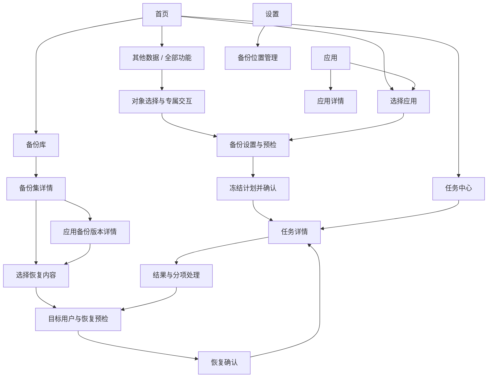

# Miuix UI 与交互规范

状态：r3（2026-11-08 实机反馈修订）。保留已确认的 KernelSU Miuix 视觉、四入口与蓝紫色数据堆叠图标；正式首版按完整上游业务能力扩展页面。原图稿是通用应用流程的视觉参考，不是完整功能目录。具体尺寸仍需设备校准。

## 已确认视觉基准

通过 ADB 观察 KernelSU v3.3.1 的 Miuix 模式，以 [已确认主页面](../ui/concept-v3-approved.png) 作为视觉方向。

保留：大标题与顶部留白、浅灰画布、纯白圆角卡片、黑色选中导航、一个有语义的彩色状态卡、克制的蓝色操作。DataBackup 2.0.12 用于参考选择/恢复流程，不能再将它的 Material 外观混入基准。

页面草稿：[主页面](../ui/concept-v3-approved.png)、[恢复与任务状态](../ui/restore-task-states.png)。图片由内置 imagegen 生成；提示词在 ui/。图中样例数值、应用图标、状态栏和字号不构成设备验证；下列状态契约优先于生图的文字与图标细节。

项目图标采用 2026-11-08 确认的蓝紫色三层数据堆叠方案，见 [项目图标规范](BRANDING.md)。页面配色继续遵循已确认的 Miuix 主题。

## 完整业务入口

保留首页 / 应用 / 备份库 / 设置。新增业务使用当前 Miuix 组件扩展，不新增一套 Material 页面，也不要求复制上游外观特效。

| 位置 | 完整能力承载 |
| --- | --- |
| 首页常用操作 | 备份应用、恢复内容、运行中任务；默认新建备份集 |
| 首页→其他数据 | Wi-Fi、通信记录（SMS/MMS/通话）、文件夹；显示独立默认值和适用条件 |
| 应用 | 普通/系统应用筛选、多用户、仅备份更新应用；名单入口和特殊数据标记 |
| 应用/对象详情 | Maps Timeline 账号映射、thanox/HMA-OSS 特殊路径；普通数据与特殊数据结果分开 |
| 备份库 | 原脚本兼容备份集、新建/更新、多个历史集、非应用对象与恢复前副本 |
| 备份集操作 | 恢复、仅恢复未安装应用、仅 AppState、独立上传、统计、检查/修复、清理 |
| 位置管理 | SMB/WebDAV 配置、发现/扫描/share、设备追踪、凭据重填、连接测试/测速 |
| 设置→备份/恢复 | 完整名单、压缩、传输、运行辅助、默认内容、低 target SDK 等经审核配置 |
| 设置→日志/维护/关于 | 日志清理、诊断、自检、受支持上游版本、HyperBackup APK 更新 |
| 任务确认/执行 | 对象与模式摘要、交互选择、执行/停止/收尾、远程完成后动作及倒计时取消 |

提供可搜索的“全部功能”目录或等效入口，覆盖矩阵的每项业务都可发现；不能只在开发命令或隐藏终端中可用。复杂的新交互需要正式页面/选择器，不能把输入框透传任意命令当作移植。

## 导航

一级四入口：**首页 / 应用 / 备份库 / 设置**。任务中心由首页右上角时钟、最近任务、运行中任务条和通知进入。运行中的任务条在其他一级页可见，点击打开同一个 taskId；从详情返回不会新建任务。

选择、配置、预检、详情属于二级页面，隐藏主导航。多用户选择对当前流程生效；主导航切换和旋转不会丢失浏览位置与未提交选择。切换来源用户时按用户分别保留选择，同时显示跨用户总量，提交前明确确认映射。

## 页面契约

| 页面 | 主要信息 | 主动作 | 关键状态 |
| --- | --- | --- | --- |
| 首次启动 | Root、平台/ABI、引擎安装、首次目的地 | 授权并检查 / 选择目的地 | 拒绝授权可浏览说明和本应用已有索引；执行按钮显示阻断原因 |
| 首页 | 上次结果、常用操作、其他数据/工具、当前位置、最近任务、运行环境 | 备份 / 恢复 / 其他数据 | 从未备份、上次部分完成、任务执行中、目的地离线不能共用绿色成功卡 |
| 应用 | 用户选择、搜索/筛选/排序、图标、名称、包名、备份记录状态 | 选择 | 扫描中保留旧数据并标时间；提供普通/白名单系统筛选；受保护目标说明原因，不能默认把系统能力藏掉 |
| 应用详情 | 安装信息、所属用户、最近记录、数据组成/估算 | 选择备份 | 大小未知不显示 0；仅高级页展示详细路径与引擎限制 |
| 选择应用 | 每用户选择集合、筛选范围、所选总量 | 下一步 | 全选只作用于当前用户和当前筛选结果；跨用户已选数量单列；全选支持部分选中 |
| 备份设置 | 新建/更新备份集、目的地、对象/数据组成、压缩与传输模式 | 检查并继续 | 改目的地、模式、配置或内容会使预检失效；更新时明确所选集会被修改 |
| 备份确认 | 所选应用、用户、容量、排除/保护策略、目标路径 | 开始备份 | 临时检查与真实执行仍有时间差，运行前再次验证 |
| 备份库 | 当前仓库、连接时间、按日期的备份集/恢复前副本、搜索 | 添加/切换位置，查看备份集 | 离线缓存、空仓库、不支持格式、无权限、未完成写入分别呈现 |
| 备份集详情 | 完成/失败/未处理数、各应用组成、校验范围 | 选择恢复 | 按源 metadata/归档检查确定可用内容；缺少 App 提交标记不等于损坏，缺失组成不默认勾选 |
| 备份版本详情 | 应用身份、来源设备/用户、日期、数据组成、其他版本 | 选择此版本恢复 | 删除在更多菜单；显示归档摘要与最近检查，不用“保证可恢复”标签 |
| 恢复预检 | 来源→目标用户、安装策略、所选数据、暂存/保护容量 | 查看阻断项 / 继续 | 未解锁用户、缺少归档、损坏、目标冲突具体定位到应用和组成 |
| 恢复确认 | 目标用户、覆盖范围、安装行为、保护副本开关/位置、高级状态恢复 | 开始恢复 | 显示按脚本沿用现有安装的条件；关闭保护只对本计划生效 |
| 任务中心 | 运行中作业、历史作业和筛选 | 查看任务 | 一次仅一个修改型作业，历史清理不等于删除备份 |
| 任务详情 | 阶段、当前应用、真实计数、速度/大小（可未知）、明细 | 停止任务 / 查看日志 | 请求停止、正在收尾、停止未确认分开；不能显示无契约的暂停继续 |
| 任务结果 | 分项结果、已写入范围、恢复前副本入口、下一步 | 重新检查未完成项 | 结果未知优先于普通失败；重试先生成新计划，不能自动重放 |
| 设置 | 完整源配置、位置管理、名单/维护、外观、诊断、关于/许可证 | 进入子项 | 引擎固定随 App 发布；不暴露任意脚本执行入口 |

## Miuix 组件映射与比例

- 使用真实 `MiuixTheme / Scaffold / TopAppBar`；公共主导航使用 `NavigationBar`，返回栈由 `miuix-nav` 负责。不用 Material 3 参数套 Miuix。
- 主标题使用对应 textStyles/TopAppBar 默认；字号随系统字体缩放，不嵌入参考手机的自定义字体。先采用标准字体比例，再通过设备预览校准。
- 页面起始水平边距约 12–16 dp、卡片间隔约 12 dp，应用行以 72–88 dp 范围试排。这是本应用的待设备校准值，不宣称为 Miuix 强制常量。
- 静态设置组使用 `SmallTitle + Card + Preference`；动态应用列表每项独立 lazy，稳定 key 使用 userId+packageName，备份列表使用 recordId/batchId。不得用一个巨型 Card 一次 compose 全列表。
- 搜索用 `SearchBar`；筛选及单用户选择用下拉/BottomSheet；多选用 `Checkbox`；必要确认用 `OverlayDialog`，复杂恢复预览使用整页。
- 顶层 `Scaffold` 负责页面 popup host 和系统安全区；列表消费其 contentPadding 一次；固定操作条/主导航各自声明底部占用，IME 不重复加 padding。
- 颜色采用默认主题与组件 Defaults。黑色选中导航按基准在已核实的公共颜色接口实现；状态绿/橙属于应用自有语义角色，集中定义明暗色。不上游不存在的 success/warning token。
- 首版不依赖模糊库，不做玻璃/壁纸/复杂转场。标准页面转场、预测返回和轻量状态过渡优先；低版本外观不因特效能力不同而失去主要内容。

## 浏览、选择与提交

应用行是详情入口，右侧状态只是摘要；点击“选择”进入显式多选流程，此时行点击等价于切换复选框，不能同时触发详情。选择工具条取代主导航区域，不叠两条底栏挤占空间。批量恢复同理。

“已备份”只说明相应来源/用户和当前索引范围有记录，不代表最新数据已受保护。实际实现优先显示“最近备份：日期”或“有历史备份”，详情展示位置与来源；离线状态带最近扫描时间。

提交按钮只在计划有效且必需检查通过时启用；点击后进入提交中、禁重复点击。若响应丢失显示“正在确认任务是否已启动”，保持原 taskId 查询，不回到可重复点击的默认按钮。

恢复确认按实际对象和模式说明覆盖、合并或仅修改状态，不能对通信记录等合并流程一律写“覆盖”。应用恢复前副本开关默认开启且显示真实保存位置。高级恢复将 SSAID、运行时权限、AppOps 等分别列出能力/适用性；未知或不支持的项目不能默默勾选。

## 模式、兼容与高影响操作

- 新建与更新并列可选，默认新建；更新说明会修改所选集，并展示 fast-skip 的实际跳过结果。任务历史不是不可变内容版本。
- 备份显式选择流式/非流式、逐应用上传和本地保留；恢复显式选择先下载/直接串流，默认先下载。模式变化使容量/预检结论失效。
- 原脚本备份没有 App hash 时说明检查范围，仍可使用源支持的恢复；直接串流不展示“全文 hash 已在覆盖前通过”。
- AppState、通信记录、Wi-Fi、系统/特殊目录和账号映射有各自范围说明；不能用一个笼统“恢复数据”按钮省去源交互。
- 扫描/5 GiB 测速显示目标、传输量与停止入口；远程电脑关机显示具体目标、源资格检查和 30 秒可取消状态，默认不擅自开启。
- metadata 重生说明只能取当前可得到状态；旧目录转换、删除/孤儿清理显示实际候选与影响，不把“修复”当无损保证。
- 更新页分别显示 App 版本、所支持的上游 SHA/版本与覆盖状态；检测到新上游不代表当前 App 已支持。运行中不允许切换引擎。

## 状态与文案

| 情况 | 推荐表达 | 避免 |
| --- | --- | --- |
| 扫描清单完成 | 已识别 3 项备份清单 | 3 个归档已通过全部校验 |
| 远端尚未回读 | 已写入，尚未回读校验 | 内容已完整验证 |
| 当前无法算总量 | 正在压缩微信的数据；不确定进度 | 伪造 46% / 剩余 1 分钟 |
| APK 更新失败但数据继续 | 安装更新失败；使用现有安装恢复数据 | 恢复成功（掩盖子项失败） |
| 同版/较新已安装 | 保留现有安装，恢复所选数据 | 已降级 / APK 恢复成功 |
| 停止已请求 | 正在停止，等待当前步骤收尾 | 已取消（引擎仍在写） |
| 进程/网络失联 | 正在确认任务状态 | 失败，立即重试 |
| 安装提交未知 | 安装结果待确认；本轮未继续写入数据 | 安装失败（可能已经成功） |
| 所选数据部分被排除 | 已保存可用部分；查看排除项 | 完整备份 |
| 归档 hash 与结构通过 | 归档校验通过 | 100% 无损 / 保证免登录 |

多数据类型作业以计划对象为计数单位，应用子项和通信记录条数单独展示，不混作一个总量。计数相互排斥：已完成 + 有警告完成 + 部分完成 + 失败 + 处理中 + 待处理 + 跳过 + 已取消 + 待确认 = 计划总数。紧凑页可以合并为摘要，但展开后必须可追溯。停止、失败与重试不能重置之前成功项目的历史记录。

## 图稿校准记录

- V3 主稿已确认风格和四入口结构；应用页左上角生图额外生成的文件图标没有对应必需动作，实际设计删除，不为装饰图标创造功能。
- 流程稿已校正为“备份清单 / 3 项已识别”；真正逐应用 hash 校验发生在下载后。
- 流程稿任务条表现为一个静态截帧；无可靠总量时实际应使用不确定进度，不按截图填充值实现。
- 灰阶、阴影、卡片细边与图库 App 图标可能由生成器引入，最终以公共 Miuix 默认组件和实机参考为准。示例使用时刻、容量均为虚构数据。

## 无障碍与设备验收

触控目标至少 48 dp；名称与包名具有独立层级，长名称不覆盖状态/复选框；TalkBack 读出用户、应用、选中和当前结果，图标按钮有动作描述。状态同时用文字与图标，不只靠颜色。

至少核对浅色/深色、字体 1.0/1.3/2.0、窄屏、横屏/分屏、键盘、手势安全区、长列表与 1000 项筛选。宽屏先约束阅读宽度，导航可改 Rail 但共享同一选中与返回状态；不因可用宽度变化重建作业。

## 2026-11-08 实机反馈约束

- Root 状态卡仅首页展示：未检查/检查中为黄色，连接失败为红色，已连接为绿色。色彩与水印参考 KernelSU v3.3.1；不能当作跨页面的全局 notice。
- 首页“备份应用”和“备份文件夹”为同级常用入口；维护、连接工具和传输按类别下钻。
- 设置页只保留实际可操作设置；主题为折叠的选择项；关于页提供实际版本、项目、反馈、发行与许可证入口。
- 缺少备份位置使用 Miuix WindowDialog 的取消/添加操作，不在内容区拼接提示与“收起提示”。
- 应用页采用搜索、紧凑筛选和应用行；备份库采用位置、搜索和备份集行。内容仅消费一次安全区，每个主入口独立保存滚动状态。
- 不添加展示实现过程、架构或验收状态的说明卡。保留影响操作决定的实际状态、错误与风险确认。
- 主体尺寸与蓝紫图标资源以 BRANDING.md 的 Miaopu 实测边界为准。
